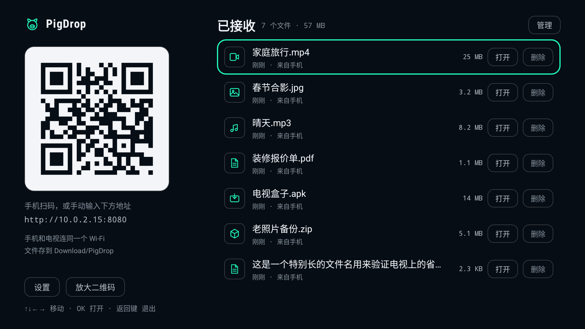
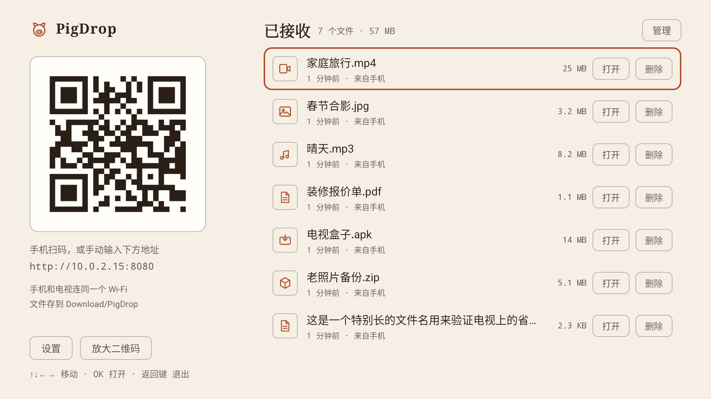
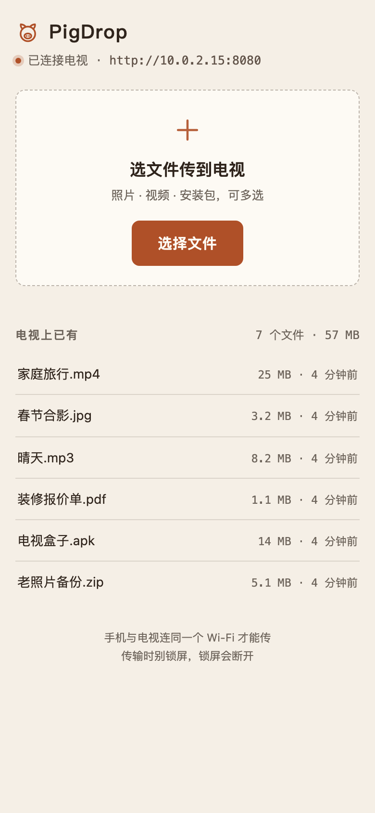
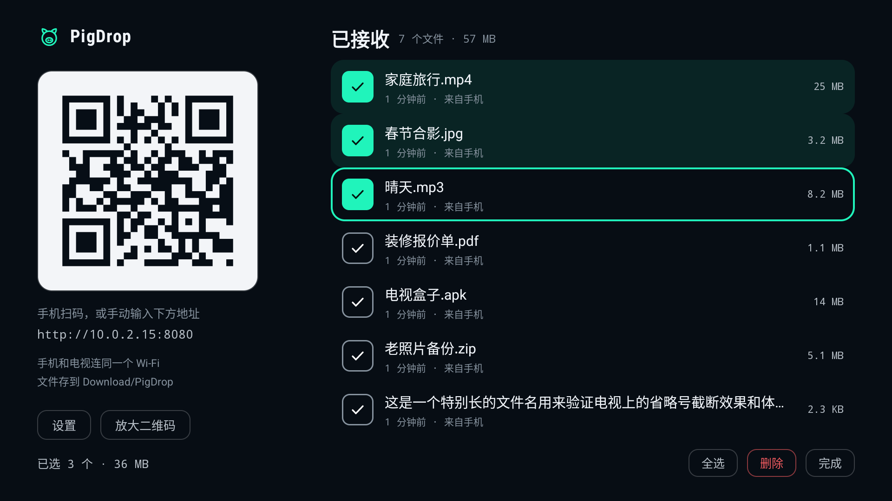
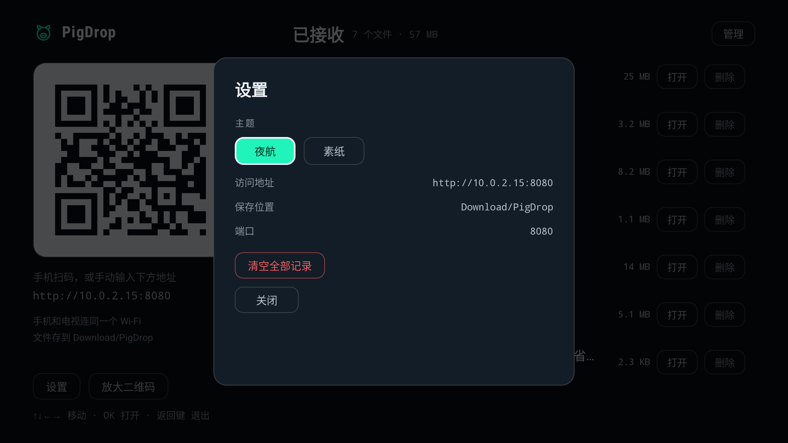
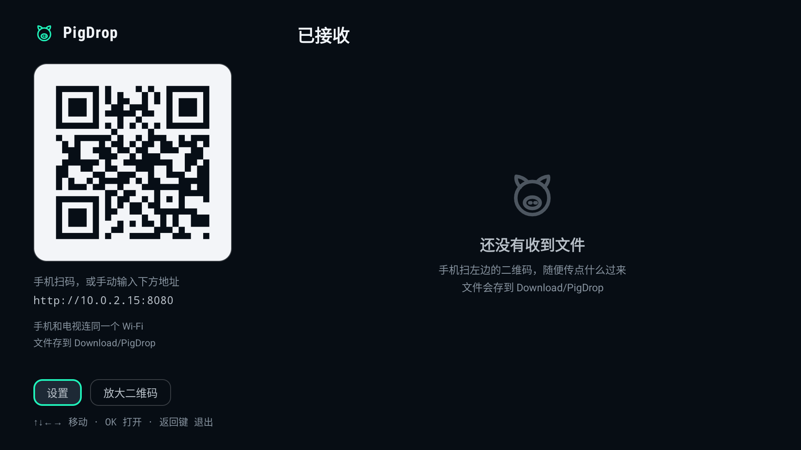
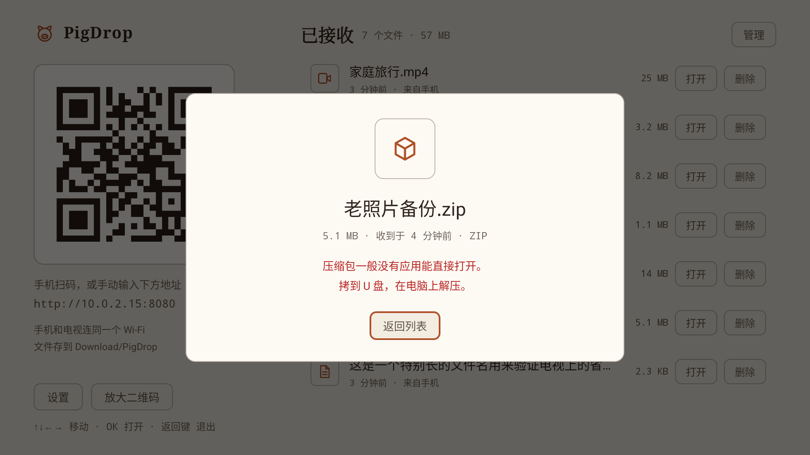

# PigDrop

> 中文名「猪猪速递」。应用桌面显示名、手机上传页标题统一为 **PigDrop**，下载目录是 `Download/PigDrop/`。

电视上打开应用，屏幕上就是一个二维码。手机扫一下，浏览器里选文件，文件直接落到电视的「下载」目录。

手机不装 App，文件不过云，全程只在你家局域网里走。

<table>
<tr>
<td width="50%"></td>
<td width="50%"></td>
</tr>
<tr>
<td align="center"><sub>夜航 · 深色</sub></td>
<td align="center"><sub>素纸 · 浅色</sub></td>
</tr>
</table>

## 怎么用

1. 电视和手机连同一个 Wi-Fi。
2. 电视上打开「PigDrop」，左边就是二维码和地址。
3. 手机扫码（或手动输入 `http://电视IP:8080`），页面上点「选择文件」。
4. 传完文件出现在电视列表里，手机上也能看到「电视上已有」的清单。

电视端全程只用遥控器：`↑↓←→` 移动，`OK` 打开；把焦点移到行内的「打开 / 删除」上再按 `OK`；右上角「管理」可以批量删。

<table>
<tr>
<td width="30%"></td>
<td width="35%"></td>
<td width="35%"></td>
</tr>
<tr>
<td align="center"><sub>手机端：不用装 App</sub></td>
<td align="center"><sub>批量管理</sub></td>
<td align="center"><sub>设置</sub></td>
</tr>
</table>

<table>
<tr>
<td width="50%"></td>
<td width="50%"></td>
</tr>
<tr>
<td align="center"><sub>还没收到文件时</sub></td>
<td align="center"><sub>电视上没有能打开它的应用时，按类型给下一步</sub></td>
</tr>
</table>

## 功能

- **手机端零安装**：上传页是电视端现场提供的 HTML，扫码即用，不依赖任何外部服务。
- **边收边写**：`PUT` 裸二进制流直接写进目标文件，不落临时文件，大文件不会占双份内存。
- **两套主题**：夜航（深色）、素纸（浅色）。手机上打开的上传页会跟着电视主题一起变。
- **遥控器全程可达**：行内左右依次是「打开 / 删除」，上下换行、末行封顶、浮层焦点不外逃，不靠几何就近猜。
- **管理已接收文件**：单选、多选、全选、删除、清空，删除前有二次确认，默认焦点在「取消」。
- **打不开时说人话**：电视上没有对应应用时，按文件类型给下一步建议，而不是弹一句英文 toast 或者干脆没反应。
- **Android 6.0 起**（API 23），同时出 `armeabi-v7a` 和 `arm64-v8a` 两个包。

## 下载安装

到 [Releases](https://github.com/andyzhang1214/Pig-Drop/releases) 下对应架构的 APK：

| 机型 | 文件 |
|---|---|
| 近几年的电视 / 盒子（64 位） | `PigDrop-1.0.0-arm64-v8a.apk` |
| 老电视、老盒子（32 位） | `PigDrop-1.0.0-armeabi-v7a.apk` |

分不清就装 `arm64-v8a`，装不上再试另一个。

装到电视：`adb install PigDrop-1.0.0-arm64-v8a.apk`，或者拷到 U 盘用电视自带的文件管理器打开。包已用正式密钥签名，不是 debug 包。

## 自己构建

需要 JDK 17+ 和 Android SDK（Platform 36）。

```bash
cd android
./gradlew :app:assembleRelease      # 正式包
./gradlew :app:assembleDebug        # 调试包
```

产物：

```
android/app/build/outputs/apk/release/app-arm64-v8a-release.apk
android/app/build/outputs/apk/release/app-armeabi-v7a-release.apk
android/app/build/outputs/apk/debug/app-arm64-v8a-debug.apk        # 调试用
android/app/build/outputs/apk/debug/app-armeabi-v7a-debug.apk
```

签名信息读工程根目录的 `keystore.properties`（已在 `.gitignore` 里，仓库不含密钥）。文件不存在时 release 自动回落到 debug 签名，克隆下来照样能构建——只是签名不同，不能覆盖安装官方包。

跑单元测试：

```bash
cd android && ./gradlew :app:testDebugUnitTest
```

## 目录

```
android/                 Android TV 应用
  app/src/main/java/com/zhuzhu/sudi/
    core/                纯 Kotlin：体积/时间文案、类型识别、文件名净化、索引编解码、流搬运
    net/                 内嵌 HTTP 服务、局域网 IP、二维码、手机页注入
    store/               存储三档降级、收到记录仓库
    ui/                  调色板、绘制、列表与行、浮层
  app/src/main/assets/www/index.html   手机端上传页（占位符由电视端注入）
  app/src/test/          29 条单元测试
design/
  prototype.html         单文件 HTML 原型（四套主题的设计定稿）
  DESIGN.md              设计上下文与取舍记录
screenshots/
```

## 几处不显然的选择

**为什么不用 `multipart/form-data`。** 传一个 4 GB 的电影时，multipart 要么整包读进内存，要么先落一份临时文件再搬。这里用 `PUT /upload?name=<文件名>` 加裸 body，`Content-Length` 已知就一路 `copy` 到底。

**为什么存储有三档降级。** API 29+ 走 MediaStore 写进系统下载目录（不申请权限）；API 23–28 只能直接写公共 `Download/PigDrop/`（需要 `WRITE_EXTERNAL_STORAGE`）；权限被拒就退到应用私有目录，功能不残废只是位置变了。设置面板里显示的「保存位置」就是当前实际生效的那一档。

**为什么自己发号。** 最初用 `max(当前时间戳, 已有最大 id + 1)` 生成 id，两个手机同时传文件会算出**同一个 id**。而删除是按 id 过滤的，撞号就会连带删掉别人的文件（实测 30 路并发出现 4 对重复 id，删一个少了两个）。改成单调发号器，启动时用历史最大 id 播种。

**为什么同名文件要自己改。** MediaStore 遇到同名会悄悄把文件重命名成 `xxx (1).mp4` 却不告诉调用方，于是列表显示的名字和磁盘上的对不上；而直接 `FileOutputStream` 同名会**截断覆盖**上一个文件。现在两种路径都先算出真实占用名，列表用磁盘上的名字。

**为什么两个 ABI 包字节完全相同。** 依赖全是纯 Java/Kotlin（NanoHTTPD、ZXing、androidx.core），没有任何 `.so`，所以 ABI 分包暂时没有东西可分。这不是问题——DEX 与 CPU 架构无关，同一个包在 32 位老盒子和 64 位新电视上都能跑。分包配置保留着，将来引入带原生库的依赖会自动真正分开。

**为什么配色要精确换算。** 原型里的颜色是 oklch 写的，落到 Android 的 `0xAARRGGBB` 时按 OKLab → LMS → linear sRGB 换算，而不是肉眼挑近似色，保证真机和原型一致。次要文字（时间、提示）的明度单独上调过，因为电视是 3 米外看的，桌面距离下的对比度在电视上偏淡。

## 已知限制

- 只能同局域网，跨网段/VLAN 不通。
- 没有断点续传，传一半断开要重传。
- 只在 API 34 的 Android TV 模拟器上验证过完整流程（含 30 路并发压测）；API 23–28 那两档存储降级路径没有真机跑过。
- 仓库里的截图来自一台 1080p 的 API 34 模拟器，真实电视上的字体渲染可能有细微差异。
- 手机端上传页不超过 6 条「电视上已有」的预览，只是清单，不能管理文件。

## 设计记录

配色、排版、遥控器焦点模型、文案口径都记在 [`design/DESIGN.md`](design/DESIGN.md)。改界面之前建议先读它，`design/prototype.html` 是当时定稿的可交互原型。
